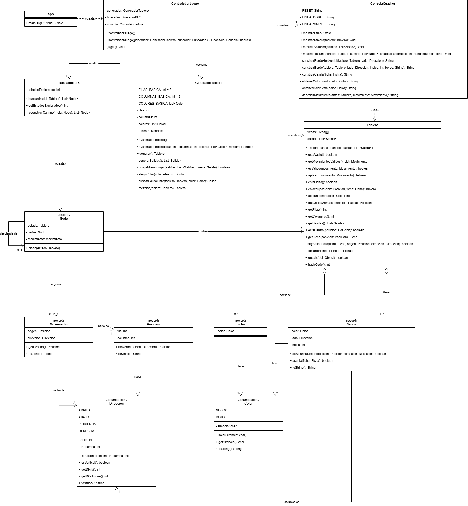

# Cuadros de Colores

Implementación en Java del juego Cuadros de Colores para consola, desarrollada para la materia de Tecnologías de Programación. El juego consiste en un tablero con fichas de colores que se mueven en cuatro direcciones (arriba, abajo, izquierda y derecha) hacia casillas desocupadas, y que pueden salir del tablero por una orilla cuando ahí hay una salida de su mismo color. El programa genera un tablero aleatorio, encuentra la secuencia con el **mínimo número de movimientos** para sacar todas las fichas y la muestra paso a paso.

Este proyecto implementa la **versión básica** del enunciado: tablero de 2x2, fichas de tamaño 1 con 2 colores distintos y 2 salidas de tamaño 1, una por cada color. El enunciado anticipa una versión intermedia (tableros NxN y fichas de tamaño 2) y una avanzada (tableros NxM y fichas en forma de L o de 2x2). Esa condición guió el diseño: el tamaño del tablero, los colores y la búsqueda no dependen de que el tablero sea de 2x2.

## Ejecución

Se requiere Java 16 o superior, ya que el proyecto utiliza `record` y *pattern matching* en `instanceof`. El proyecto no depende de ningún IDE ni de bibliotecas externas; para compilarlo y ejecutarlo desde una terminal, en la raíz del proyecto:

```
javac -d bin src/*.java
java -cp bin App
```

Las pruebas manuales se ejecutan con:

```
java -cp bin PruebasTablero
```

También puede abrirse en cualquier IDE con soporte para Java (VS Code, IntelliJ IDEA, Eclipse, NetBeans), marcando `src` como carpeta de código fuente y ejecutando la clase `App`.

El tablero se dibuja con colores mediante códigos de escape ANSI. La terminal integrada de VS Code, Windows Terminal y las terminales de Linux y macOS los interpretan correctamente; en la consola clásica de Windows (`cmd.exe` antiguo) pueden mostrarse como caracteres extraños del tipo `←[41m`. Los textos del programa se escribieron sin acentos para evitar problemas de codificación en la consola de Windows.

## Flujo del programa

El programa no requiere datos del usuario: la versión básica se construye con los valores por defecto (constructor sin parámetros).

1. Se muestra el título.
2. `GeneradorTablero` crea un tablero de 2x2 aleatorio con dos salidas, una negra y una roja, y lo llena de fichas garantizando que tenga solución.
3. `BuscadorBFS` encuentra la secuencia mínima de movimientos para vaciar el tablero.
4. `ConsolaCuadros` muestra el tablero inicial y, para cada movimiento, qué ficha se movió, hacia dónde, si salió del tablero y cómo quedó el tablero.
5. Al final se imprime un resumen con el tamaño del tablero, los movimientos mínimos, los estados explorados por la búsqueda, el tiempo de búsqueda, las salidas y la cantidad de fichas de cada color.

Ejemplo de un tablero (las letras en el borde son las salidas):

```
+-N----+
| N  R |
| R  N |
+----R-+
```

## Reglas del juego

- En cada movimiento se desplaza **una sola ficha** una casilla en una de las cuatro direcciones.
- Una ficha solo puede moverse a una casilla vacía; no puede sobreponerse a otra ficha.
- Una ficha sale del tablero cuando está en la orilla, se mueve hacia afuera y en ese punto hay una salida de **su mismo color**. Frente a una salida de otro color el movimiento no es válido.
- Salir del tablero cuenta como un movimiento.
- El juego termina cuando el tablero queda vacío.

### Cumplimiento del enunciado

| Requisito | Cómo se cumple |
|---|---|
| Fichas colocadas aleatoriamente | `GeneradorTablero` decide al azar las salidas, el color de las fichas y una serie de movimientos de mezcla |
| Al menos una salida coincide con el color de la ficha adyacente | El tablero generado está lleno y tiene solución; como no hay casillas libres, el primer movimiento de la solución tiene que ser una ficha saliendo por una salida de su color |
| Colores no necesariamente uniformes | Después de garantizar una ficha de cada color, el resto se elige al azar (por ejemplo, 3 rojas y 1 negra) |
| Lista de movimientos mínima | Búsqueda en anchura (BFS) |
| Imprimir cada movimiento | `ConsolaCuadros.mostrarSolucion` dibuja el tablero después de cada paso |
| Siempre debe haber solución | El tablero se genera jugando al revés desde el tablero vacío (ver *Decisiones de diseño*) |
| Constructor sin parámetros, 2x2, 2 colores, 2 salidas | `ControladorJuego()` y `GeneradorTablero()` usan los valores de la versión básica |

## Decisiones de diseño

### Representación del estado

El estado del juego es la **distribución de las fichas** en el tablero. Las salidas forman parte del tablero pero no cambian durante la partida, por lo que todos los estados de una misma partida comparten la misma lista de salidas en lugar de copiarla.

El tablero se representa con una matriz `Ficha[][]` en la que `null` significa casilla vacía. La posición de una ficha está implícita en el índice de la matriz y no se guarda dentro de la ficha; guardar el mismo dato en dos lugares abriría la posibilidad de que se desincronizaran.

Se separó el **estado** (`Tablero`) del **nodo de búsqueda** (`Nodo`), siguiendo el capítulo 2 de *Classic Computer Science Problems in Java* (Kopec). El estado describe cómo está el tablero; el nodo agrega la historia de cómo se llegó a él (el nodo padre y el movimiento aplicado). Si el estado incluyera esa historia, dos caminos distintos que llegan al mismo tablero se considerarían estados diferentes y la búsqueda repetiría trabajo.

### Tablero inmutable

`Tablero` es inmutable: `aplicar(movimiento)` y `colocar(posicion, ficha)` devuelven un tablero nuevo y dejan intacto el original. La búsqueda necesita conservar muchos estados a la vez (en la cola y en el conjunto de explorados), y si un sucesor modificara a su padre, se corromperían los estados ya guardados.

Para garantizar la inmutabilidad, el constructor hace una **copia profunda** de la matriz: copia cada fila y no solo el arreglo exterior, ya que `clone()` sobre un `Ficha[][]` deja las filas compartidas. Además, la clase no expone la matriz; las demás clases consultan las casillas con `getFicha(posicion)`. Las fichas pueden compartirse entre tableros porque son `record` y tampoco cambian.

### Igualdad de estados

La búsqueda descarta los estados repetidos con un `HashSet<Tablero>`, por lo que `Tablero` sobrescribe `equals()` y `hashCode()` con `Arrays.deepEquals` y `Arrays.deepHashCode` sobre la matriz. Sin esto, dos tableros iguales construidos por separado se considerarían distintos y la búsqueda podría ciclarse (una ficha que va a la derecha y regresa a la izquierda indefinidamente). Las salidas no se comparan porque son las mismas en todos los estados de una partida.

`Ficha` contiene únicamente su color. Por eso dos fichas del mismo color son iguales, y dos tableros que solo difieren en *cuál* ficha roja está en cada casilla se reconocen como el mismo estado: tienen exactamente los mismos movimientos posibles y la misma solución.

### Búsqueda en anchura

De los algoritmos de búsqueda del capítulo 2 del libro (DFS, BFS y A\*), se eligió **BFS** porque garantiza el camino más corto cuando todos los movimientos cuestan lo mismo: explora primero todos los estados a un movimiento, luego todos los que están a dos, y así sucesivamente, por lo que el primer tablero vacío que encuentra está a la menor profundidad posible. DFS no ofrece esa garantía, y A\* requeriría una heurística que, para un tablero de 2x2, no aporta una mejora apreciable.

La implementación sigue la del libro, con dos detalles:

- Un estado se marca como explorado **al entrar a la cola** y no al salir, para que un mismo tablero no se encole varias veces.
- La condición de meta se revisa **al sacar** el nodo de la cola, de modo que un tablero que ya está vacío se resuelve con cero movimientos.

El camino se reconstruye siguiendo los padres desde el nodo meta hasta el inicial y después se invierte. `buscar()` devuelve la lista de nodos (y no solo los movimientos) para que la vista pueda mostrar el tablero resultante de cada paso; devuelve `null` si no existe solución, lo que lo distingue del caso de un tablero ya resuelto (una lista con un solo nodo).

Con el tablero del ejemplo del enunciado (`N R / R N`, salida negra arriba de la columna 0 y salida roja abajo de la columna 1), la búsqueda encuentra una solución de **10 movimientos**, la misma cantidad que muestra la secuencia del PDF.

### Generación del tablero jugando al revés

El requisito de que siempre exista solución se resolvió **construyendo** el tablero de manera que la tenga, en lugar de generarlo al azar y validarlo después. La idea se basa en que todos los movimientos del juego son reversibles: mover una ficha a una casilla vacía se deshace regresándola, y sacarla por una salida se deshace metiéndola por la misma salida.

`GeneradorTablero` parte del tablero vacío (la meta) y repite dos operaciones del juego inverso hasta llenarlo:

1. **Entrar:** coloca una ficha en la casilla adyacente a una salida libre de su color.
2. **Mezclar:** aplica entre 1 y (número de casillas) movimientos aleatorios dentro del tablero, para que las fichas no queden siempre amontonadas junto a las salidas.

Al invertir esa secuencia se obtiene una forma de vaciar el tablero, así que cualquier tablero generado tiene solución. La alternativa de generar al azar y validar con BFS funciona para 2x2, pero en las versiones con tableros de hasta 14x14 validar cada intento sería muy costoso; el enfoque inverso funciona igual con cualquier tamaño y con fichas de varias casillas, ya que sus movimientos también son reversibles.

Otras decisiones del generador:

- Las salidas se eligen primero, una por color, en un lado e índice aleatorios y sin repetir el mismo lugar.
- Las primeras fichas usan cada color una vez para garantizar que aparezcan todos; las demás se eligen al azar.
- El `Random` se recibe por constructor, de modo que en las pruebas puede usarse una semilla fija y obtener siempre los mismos tableros.
- Los valores de la versión básica (`FILAS_BASICA`, `COLUMNAS_BASICA`, `COLORES_BASICA`) son constantes, pero el tamaño y los colores se guardan como atributos. El constructor sin parámetros usa los valores básicos y el constructor completo permite crear tableros de otro tamaño sin modificar la clase.

### Salidas

Una salida no ocupa una casilla: está en una orilla. Por eso se identifica con su **lado** (`Direccion`) y un **índice** sobre ese lado, que es la columna en los lados de arriba y abajo y la fila en los lados izquierdo y derecho. Reutilizar `Direccion` para el lado tiene una ventaja adicional: para salir por una salida, la ficha tiene que moverse justamente en la dirección de ese lado.

`Salida` responde si se alcanza desde una posición moviéndose en una dirección (`seAlcanzaDesde`) y si acepta una ficha según su color (`acepta`); ambas cosas dependen solo de sus propios datos. La comprobación de que la posición está en la orilla corresponde a `Tablero`, que es quien conoce sus dimensiones; por la misma razón, `getCasillaAdyacente(salida)` está en `Tablero` y no en `Salida`.

### Enumeraciones y records

`Color` y `Direccion` son enumeraciones porque representan conjuntos cerrados, y un `String` o un `int` admitirían valores inválidos que el compilador no puede detectar. `Direccion` guarda el desplazamiento en filas y columnas de cada constante, de modo que `Posicion.mover(direccion)` no necesita condicionales. Ambas sobrescriben `toString()` para mostrarse en minúsculas (`rojo`, `abajo`).

`Ficha`, `Salida`, `Posicion`, `Movimiento` y `Nodo` son `record`: son objetos de valor que no cambian después de crearse, y el `record` genera el constructor, los accesores, `equals()` y `hashCode()`.

Aunque en la versión básica `Ficha` solo contiene un color y podría sustituirse por una matriz `Color[][]`, se mantuvo como clase propia porque el enunciado ya anticipa fichas de tamaño 2, en L y de 2x2, que necesitarán más datos (tamaño, orientación, identificador). Con `Ficha` como tipo, ese cambio queda contenido en la clase (Variaciones protegidas).

### Responsabilidades (GRASP)

| Principio | Aplicación |
|---|---|
| Experto en información | `Tablero` decide si un movimiento es válido, aplica movimientos y cuenta fichas, porque tiene la matriz y las salidas. `Salida` decide si se alcanza desde una posición y si acepta una ficha. `Posicion` calcula su vecina en una dirección |
| Creador | `GeneradorTablero` crea los tableros iniciales; `BuscadorBFS` crea los nodos; `ControladorJuego` crea las piezas con las que trabaja |
| Controlador | `ControladorJuego` recibe la orden de jugar y la reparte: generar, buscar y mostrar. No contiene reglas del juego ni textos |
| Alta cohesión | La búsqueda, la generación y la presentación están en clases separadas; `Tablero` no sabe buscar ni imprimirse |
| Bajo acoplamiento | El modelo (`Tablero`, `Ficha`, `Salida`, etc.) no conoce al buscador ni a la vista |
| Fabricación pura | `GeneradorTablero`, `BuscadorBFS` y `ConsolaCuadros` no representan conceptos del juego; existen para repartir responsabilidades |
| Variaciones protegidas | `Ficha` como clase propia y el generador parametrizable aíslan los cambios esperados en las versiones intermedia y avanzada |

### Separación entre lógica y presentación

Toda la salida a pantalla está en `ConsolaCuadros`, de modo que las clases del modelo y de la búsqueda no contienen `System.out`. Los códigos de color ANSI también viven en la consola y no en el enum `Color`: el modelo dice *qué* color tiene una ficha y la vista decide *cómo* se dibuja.

Las fichas se dibujan con **fondo de color** y la letra en blanco, para que la casilla completa se distinga de un vistazo como en las figuras del enunciado; el negro se muestra en gris oscuro porque el negro puro desaparece en terminales de fondo oscuro. Las salidas, que ocupan un solo carácter del borde, se dibujan con la letra coloreada. Para concordar con el texto sin agregar formas femeninas al enum, los mensajes usan el color como sustantivo: "Ficha de color rojo", "Salida de color negro".

### Medición de la búsqueda

`BuscadorBFS` cuenta los estados que expande en la última búsqueda (`getEstadosExplorados()`), y `ControladorJuego` mide el tiempo con `System.nanoTime()` alrededor de la llamada a `buscar()`. Solo se mide la búsqueda, no la generación ni la impresión, porque escribir en consola es lento y distorsionaría el resultado.

### Estilo del código

Los métodos siguen la convención de Java de nombrarse con verbos (`aplicar`, `colocar`, `buscar`) o como preguntas de sí o no (`estaVacio`, `esValido`, `seAlcanzaDesde`); las consultas usan el prefijo `get`. Cada método tiene un único `return`, y los constructores no validan sus argumentos: los únicos que crean objetos del modelo son el generador y las pruebas, que siempre pasan valores válidos.

## Clases

### App

Punto de entrada del programa. Crea el controlador de la versión básica e inicia el juego.

| Método | Acceso | Descripción |
|---|---|---|
| `main(String[] args)` | public static | Crea un `ControladorJuego` con el constructor sin parámetros y llama a `jugar()` |

### ControladorJuego

Coordina el juego: genera el tablero, busca la solución, mide el tiempo y pide a la consola que muestre los resultados. No contiene reglas del juego ni textos.

| Método | Acceso | Descripción |
|---|---|---|
| `ControladorJuego()` | public | Versión básica: crea un generador de 2x2 con dos colores, un buscador y una consola |
| `ControladorJuego(GeneradorTablero, BuscadorBFS, ConsolaCuadros)` | public | Recibe las piezas ya configuradas, por ejemplo un generador con semilla o de otro tamaño |
| `jugar()` | public | Muestra el título, genera el tablero, busca la solución midiendo el tiempo y muestra la solución y el resumen |

### ConsolaCuadros

Vista en consola y única clase que escribe en pantalla. Dibuja el tablero con las salidas sobre el borde y con colores ANSI. Define las constantes `RESET`, `LINEA_DOBLE` y `LINEA_SIMPLE`.

| Método | Acceso | Descripción |
|---|---|---|
| `mostrarTitulo()` | public | Imprime el encabezado del programa |
| `mostrarTablero(Tablero tablero)` | public | Dibuja el tablero con sus fichas y salidas |
| `mostrarSolucion(List<Nodo> camino)` | public | Muestra el tablero inicial y cada movimiento con el tablero resultante; avisa si no hay solución |
| `mostrarResumen(Tablero inicial, List<Nodo> camino, int estadosExplorados, long nanosegundos)` | public | Imprime tamaño, movimientos mínimos, estados explorados, tiempo, salidas y fichas por color |
| `construirBordeHorizontal(Tablero, Direccion lado)` | private | Arma la línea superior o inferior con las salidas en su columna |
| `construirBorde(Tablero, Direccion lado, int indice, String borde)` | private | Devuelve la letra coloreada de la salida en ese lugar, o el carácter de borde si no hay |
| `construirCasilla(Ficha ficha)` | private | Casilla de tres caracteres con fondo de color, o un punto si está vacía |
| `obtenerColorFondo(Color color)` | private | Código ANSI de fondo para cada color |
| `obtenerColorLetra(Color color)` | private | Código ANSI de letra para cada color |
| `describirMovimiento(Tablero antes, Movimiento movimiento)` | private | Texto del paso, por ejemplo `Ficha de color rojo (1,1) -> abajo, sale del tablero`; usa el tablero anterior porque después del movimiento la ficha ya no está en su origen |

### BuscadorBFS

Búsqueda en anchura de la secuencia mínima de movimientos para vaciar el tablero.

| Método | Acceso | Descripción |
|---|---|---|
| `buscar(Tablero inicial)` | public | Devuelve el camino de nodos desde el tablero inicial hasta el vacío, o `null` si no hay solución |
| `getEstadosExplorados()` | public | Cantidad de estados que expandió la última búsqueda |
| `reconstruirCamino(Nodo meta)` | private | Sigue los padres desde la meta y devuelve el camino ordenado del inicio a la meta |

### GeneradorTablero

Genera tableros aleatorios con solución garantizada jugando al revés desde el tablero vacío. Define las constantes `FILAS_BASICA = 2`, `COLUMNAS_BASICA = 2` y `COLORES_BASICA` (negro y rojo).

| Método | Acceso | Descripción |
|---|---|---|
| `GeneradorTablero()` | public | Versión básica: 2x2, negro y rojo, con un `Random` sin semilla |
| `GeneradorTablero(int filas, int columnas, List<Color> colores, Random random)` | public | Permite elegir tamaño, colores y semilla |
| `generar()` | public | Crea las salidas y mete fichas por ellas, mezclando después de cada entrada, hasta llenar el tablero |
| `generarSalidas()` | private | Una salida por color en un lado e índice aleatorios, sin repetir lugar |
| `ocupaMismoLugar(List<Salida>, Salida nueva)` | private | Comprueba si ya existe una salida en el mismo lado e índice |
| `elegirColor(int colocadas)` | private | Primero un color de cada uno; después, al azar |
| `buscarSalidaLibre(Tablero, Color)` | private | Salida del color pedido cuya casilla adyacente está vacía, o `null` |
| `mezclar(Tablero)` | private | Aplica entre 1 y (número de casillas) movimientos aleatorios sin sacar fichas |

### Tablero

Estado del juego: matriz de fichas y lista de salidas. Es inmutable y es el experto en las reglas de movimiento.

| Método | Acceso | Descripción |
|---|---|---|
| `Tablero(Ficha[][] fichas, List<Salida> salidas)` | public | Copia la matriz en profundidad y guarda una lista no modificable de salidas |
| `estaVacio()` | public | Condición de meta: no queda ninguna ficha |
| `getMovimientosValidos()` | public | Sucesores: prueba las cuatro direcciones de cada ficha y devuelve las válidas |
| `esValido(Movimiento)` | public | Dentro del tablero, el destino debe estar vacío; fuera, debe haber una salida alcanzable de su color |
| `aplicar(Movimiento)` | public | Devuelve un tablero nuevo con el movimiento aplicado; si la ficha sale, simplemente no se coloca |
| `estaLleno()` | public | Todas las casillas están ocupadas |
| `colocar(Posicion, Ficha)` | public | Devuelve un tablero nuevo con la ficha en esa casilla |
| `contarFichas(Color)` | public | Cantidad de fichas de un color |
| `getCasillaAdyacente(Salida)` | public | Casilla del tablero pegada a una salida |
| `getFilas()`, `getColumnas()` | public | Dimensiones, calculadas a partir de la matriz |
| `getSalidas()` | public | Lista no modificable de salidas |
| `estaDentro(Posicion)` | public | Comprueba si la posición está dentro de los límites |
| `getFicha(Posicion)` | public | Ficha en esa casilla, o `null` si está vacía o fuera del tablero |
| `haySalidaPara(Ficha, Posicion origen, Direccion)` | private | Busca una salida que se alcance desde el origen y acepte la ficha |
| `copiar(Ficha[][])` | private static | Copia profunda de la matriz |
| `equals(Object)`, `hashCode()` | public | Igualdad por contenido de la matriz, necesaria para el conjunto de explorados |

### Nodo (record)

Paso en el árbol de búsqueda, con los componentes `estado` (`Tablero`), `padre` (`Nodo`) y `movimiento` (`Movimiento`). En el nodo inicial, el padre y el movimiento son `null`.

| Método | Acceso | Descripción |
|---|---|---|
| `estado()`, `padre()`, `movimiento()` | public | Accesores generados por el `record` |
| `Nodo(Tablero estado)` | public | Atajo para crear el nodo inicial |

### Salida (record)

Salida en una orilla del tablero, con los componentes `color`, `lado` (`Direccion`) e `indice` (columna en los lados de arriba y abajo, fila en los lados izquierdo y derecho).

| Método | Acceso | Descripción |
|---|---|---|
| `seAlcanzaDesde(Posicion, Direccion)` | public | Verdadero si la dirección coincide con el lado y la posición está en la fila o columna de la salida |
| `acepta(Ficha)` | public | Verdadero si la ficha es del color de la salida |
| `toString()` | public | Por ejemplo `Salida de color rojo: abajo, columna 1` |

### Movimiento (record)

Movimiento de una ficha, con los componentes `origen` (`Posicion`) y `direccion` (`Direccion`).

| Método | Acceso | Descripción |
|---|---|---|
| `getDestino()` | public | Posición a la que llegaría la ficha; puede quedar fuera del tablero si sale |
| `toString()` | public | Por ejemplo `(1,1) -> abajo` |

### Posicion (record)

Casilla del tablero, con los componentes `fila` y `columna`.

| Método | Acceso | Descripción |
|---|---|---|
| `mover(Direccion)` | public | Posición vecina en esa dirección; no valida los límites, porque no conoce el tamaño del tablero |
| `toString()` | public | Por ejemplo `(0,1)` |

### Ficha (record)

Ficha de tamaño 1 con el componente `color`. No guarda su posición, que está dada por la matriz del tablero.

### Direccion (enum)

Las cuatro direcciones, `ARRIBA`, `ABAJO`, `IZQUIERDA` y `DERECHA`, cada una con su desplazamiento en filas y columnas. También se usa para indicar el lado del tablero en el que está una salida.

| Método | Acceso | Descripción |
|---|---|---|
| `Direccion(int dFila, int dColumna)` | private | Constructor de cada constante |
| `esVertical()` | public | Verdadero para `ARRIBA` y `ABAJO` |
| `getDFila()`, `getDColumna()` | public | Desplazamiento en filas y en columnas |
| `toString()` | public | Nombre en minúsculas, por ejemplo `abajo` |

### Color (enum)

Los colores de la versión básica, `NEGRO` y `ROJO`, cada uno con la letra que lo representa en el tablero.

| Método | Acceso | Descripción |
|---|---|---|
| `Color(char simbolo)` | private | Constructor de cada constante |
| `getSimbolo()` | public | Letra del color, por ejemplo `'R'` |
| `toString()` | public | Nombre en minúsculas, por ejemplo `rojo` |

### PruebasTablero

Pruebas manuales que imprimen `[OK]` o `[FALLA]` por cada verificación. Se agrupan en tres métodos:

- `probarTablero()`: movimientos válidos, salida rechazada por color, inmutabilidad de `aplicar()`, `equals()`/`hashCode()`, copia profunda, `estaVacio()` y `estaLleno()`.
- `probarBuscador()`: la solución del ejemplo del enunciado tiene 10 movimientos y termina en un tablero vacío; un tablero vacío se resuelve con cero movimientos.
- `probarGenerador()`: con una semilla fija, los tableros generados están llenos y tienen solución.

### Keyboard

Utilería de lectura de teclado proporcionada en el curso (Lewis y Loftus). La versión básica no la utiliza, porque el juego no pide datos al usuario; se conserva para las versiones siguientes, en las que se capturará el tamaño del tablero y el número de colores.

## Trabajo futuro

- **Versión intermedia:** `GeneradorTablero` ya acepta otro tamaño y otra lista de colores. Faltan las fichas de tamaño 2, que requieren que `Ficha` tenga tamaño, orientación e identificador, y que `Tablero` mueva todas las casillas de una ficha a la vez. También habrá que capturar los parámetros con `Keyboard` desde `ConsolaCuadros`.
- **Versión avanzada:** tableros NxM y fichas en L o de 2x2. En tableros grandes, el número de estados crece rápidamente; si BFS resulta demasiado lento, A\* con una heurística admisible (por ejemplo, la suma de las distancias de cada ficha a su salida más cercana) conservaría la garantía de solución mínima.

## Diagrama de clases



El archivo editable se encuentra en [`docs/CuadroDeColores.drawio`](docs/CuadroDeColores.drawio).

## Referencias

- Kopec, D. (2020). *Classic Computer Science Problems in Java*. Manning. Capítulo 2: problemas de búsqueda (DFS, BFS y A\*).
- Enunciado del proyecto: [`docs/Proyecto_CuadrosdeColores.pdf`](docs/Proyecto_CuadrosdeColores.pdf).

## Autor

- *Nombre del autor* ([Sebastian1247](https://github.com/Sebastian1247))

Tecnologías de Programación, Maestría en Ciencias de la Computación, 1er semestre. [Tecnológico Nacional de México, Campus Culiacán](https://www.culiacan.tecnm.mx/posgrados/maestria-en-ciencias-de-la-computacion/)
